<p align="center">
  
</p>

<p align="center">
  <a href="https://github.com/korczis/prismatic-flipperzero/actions/workflows/ci.yml"></a>
  <a href="https://github.com/korczis/prismatic-flipperzero/releases"></a>
  
  <a href="https://korczis.github.io/prismatic-flipperzero/"></a>
  <a href="docs/case-study.md"></a>
  <a href="https://majordomus.dev"></a>
</p>

<p align="center">
  <b>Prismatic Pocket</b> puts a whole book on epistemic self-defence into a Flipper Zero.<br>
  Read it, recognise what is happening to you, decide what to do, and train until it is reflex,<br>
  with no network, no phone and no account.
</p>

<p align="center">
  <a href="#what-it-is">What it is</a> ·
  <a href="#on-a-real-device">On a real device</a> ·
  <a href="#what-is-inside">What is inside</a> ·
  <a href="#how-it-works">How it works</a> ·
  <a href="#install">Install</a> ·
  <a href="#build-it-yourself">Build</a> ·
  <a href="#how-it-is-kept-honest">Guarantees</a> ·
  <a href="docs/case-study.md">Case study</a> ·
  <a href="https://korczis.github.io/prismatic-flipperzero/">Explorer</a> ·
  <a href="https://github.com/korczis/prismatic-flipperzero/wiki">Wiki</a>
</p>

> **Try it without a Flipper.** The [online explorer](https://korczis.github.io/prismatic-flipperzero/)
> is the same pack in a browser: a drillable map of every category, search, every article with
> its relation tree, the detector and both quizzes. Object *n* there is object *n* on the device.

---

## What it is

Manipulation rarely announces itself. It shows up as a deadline you cannot verify, a choice
narrowed to two bad options, a colleague who remembers the meeting differently every time, an
expert whose credentials quietly stop counting. The
[Kompendium epistemické anihilace](https://github.com/korczis/kompendium-epistemicke-anihilace)
is a book about exactly that. It describes how people's ability to know things is undermined and
how to defend it: techniques, detection signatures, fallacies, NLP patterns, case studies,
emergency and recovery protocols, a glossary.

A book is the wrong shape for the moment you need it. When the pressure is on you need three
things fast: *is this the pattern I think it is*, *what else could it be*, and *what do I do
now*. **Prismatic Pocket** turns the book into that tool and puts it in a device you already carry
for other reasons.

- **Encyclopedia.** Every page of the Kompendium becomes an article: a definition, the markers to
  look for, what to do, when to escalate, what not to confuse it with, the chapters, and links to
  everything related.
- **Detector.** Where the book lists observable markers, you walk through them one at a time
  and mark each one *observed*, *not observed*, *unknown* or *not applicable*. You get your marks
  back, then what to rule out first, how to validate it, and the next steps. The detector **does
  not score, rank or diagnose anyone**. A marker describes; it never proves.
- **Applicator.** Every article with response guidance offers it directly: first safe reaction,
  escalation and handover.
- **Trainer.** Two quiz modes derived from the data. *Which term is this?* masks the name in a
  definition and offers confusable alternatives. *Manipulative or benign?* uses the catalogue's
  example utterances and explains the marker and a good response.

Everything on the device is **derived** from the book by a compiler. There is no hand-written
content in the app and no per-topic code: adding a page to the Kompendium adds an article,
and its detector and quiz when the page carries the material for them.

## On a real device

Every frame below was **read from the Flipper's screen over USB** by
[`tools/flipper_screen.py`](tools/flipper_screen.py) through the official RPC screen stream.
None of them is a mock-up.

<!-- docs:begin screens -->
<table>
  <tr><td align="center" width="50%">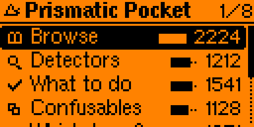<br><sub>Home: every count is derived from the pack on the SD card</sub></td><td align="center" width="50%">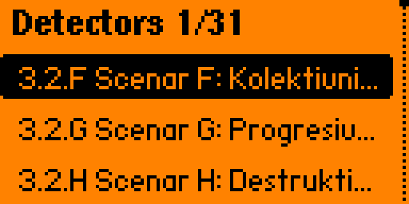<br><sub>Detectors: objects whose page lists observable markers</sub></td></tr>
  <tr><td align="center" width="50%">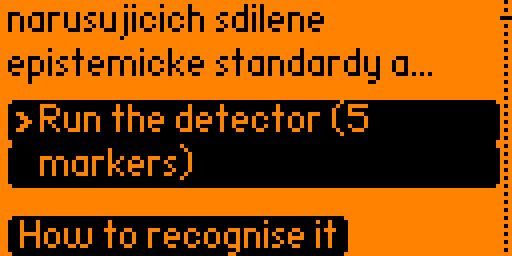<br><sub>Right jumps to the next link; OK opens it</sub></td><td align="center" width="50%">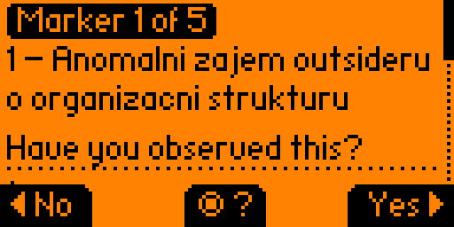<br><sub>Detector: one marker at a time, No / ? / Yes, hold OK for n/a</sub></td></tr>
  <tr><td align="center" width="50%">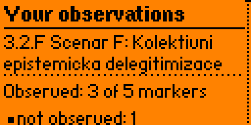<br><sub>Result: your own marks back, never a score</sub></td><td align="center" width="50%">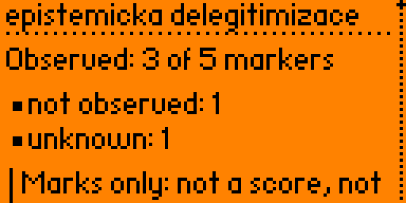<br><sub>Then what to rule out first and the next steps</sub></td></tr>
  <tr><td align="center" width="50%">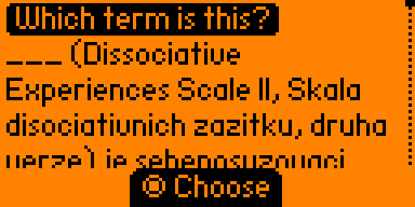<br><sub>Quiz: which term is this? The name is masked in the definition</sub></td><td align="center" width="50%">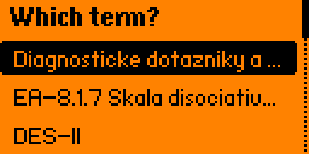<br><sub>Distractors come from the objects the page calls confusable</sub></td></tr>
  <tr><td align="center" width="50%">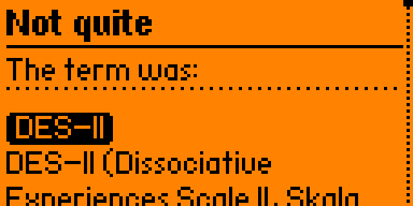<br><sub>The answer, with the full definition and a link to the article</sub></td><td align="center" width="50%">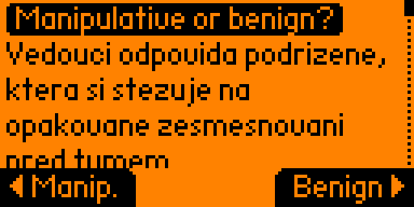<br><sub>Trainer: manipulative or benign? A catalogue example in context</sub></td></tr>
  <tr><td align="center" width="50%">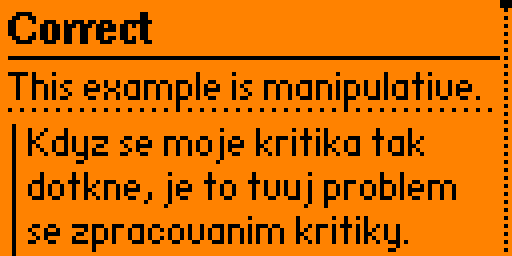<br><sub>Why, and a good response, from the catalogue</sub></td><td align="center" width="50%">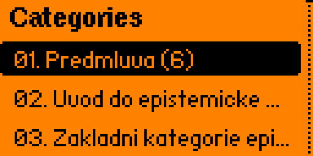<br><sub>Browse: the Kompendium's own chapters and collections</sub></td></tr>
  <tr><td align="center" width="50%">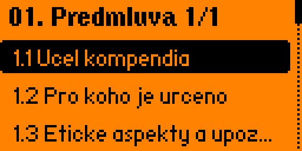<br><sub>A category, paged; Back returns to the same row</sub></td><td align="center" width="50%">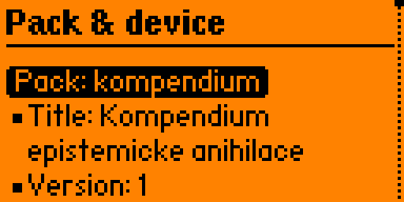<br><sub>Pack and device info: source commit, contents</sub></td></tr>
  <tr><td align="center" width="50%">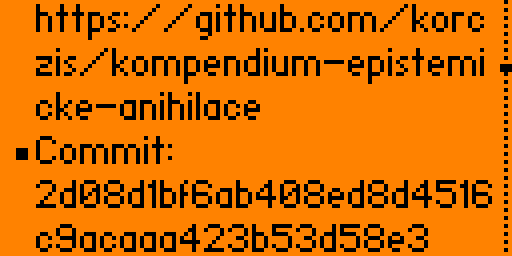<br><sub>Provenance: the source repository and the pinned commit</sub></td></tr>
</table>

Captured 2026-11-25 on firmware 1.5.1 with `tools/capture-screens.sh`.
<!-- docs:end screens -->

The text renderer ([`app/reader.c`](app/reader.c)) is written for this 128 × 64 display. It
wraps lines by real glyph widths and draws a ruled title, inverted section labels,
hanging-indent bullets, quoted notes, selectable links and a button bar. The firmware's fonts
are ASCII-only (measured: [`docs/evidence/fonts`](docs/evidence/fonts)), so the compiler folds
Czech diacritics for the device and keeps the original text everywhere else.

## What is inside

The pack is compiled from the Kompendium at a pinned commit. These numbers come from the pack
build report and are regenerated by [`tools/docs.py`](tools/docs.py). CI refuses a README whose
numbers disagree with the build.

<!-- docs:begin pack-stats -->
| | |
|---|---:|
| Knowledge objects | **2 224** |
| Categories | **64** |
| Typed relations (links between objects) | **37 567** |
| Objects with a detector (observable markers) | **1 212** |
| Objects with what-to-do steps | **1 541** |
| Objects with confusables to rule out | **1 128** |
| Quiz questions | **2 856** |
|   of which: recognise the term from its definition | **1 671** |
|   of which: manipulative or benign? (catalogue examples) | **1 185** |
| Markers (indicators) | **4 246** |
| Actions and escalation steps | **4 558** |
| Chapters | **16 789** |

Pack `kompendium.pkp`: 20 649 388 bytes, sha256 `6752496025b2cdb6…`, rebuilt byte-for-byte identical by CI from the pinned source.
<!-- docs:end pack-stats -->

<details>
<summary>Object kinds</summary>

<!-- docs:begin pack-kinds -->
| Kind | Objects | Share |
|---|---:|---|
| `article` | 552 | `██████` 24.8 % |
| `technique` | 503 | `█████` 22.6 % |
| `pattern` | 420 | `█████` 18.9 % |
| `concept` | 289 | `███` 13.0 % |
| `fallacy` | 147 | `██` 6.6 % |
| `scenario` | 120 | `█` 5.4 % |
| `protocol` | 80 | `█` 3.6 % |
| `countermeasure` | 50 | `█` 2.2 % |
| `signature` | 33 | `█` 1.5 % |
| `exercise` | 30 | `█` 1.3 % |
<!-- docs:end pack-kinds -->

</details>

## How it works

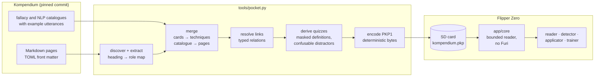

**One declarative map, no per-topic code.** [`knowledge/sources.json`](knowledge/sources.json)
says which collections become which kind of object and which headings play which role. For
example, *Jak ji poznat* and *Pozorovatelné markery* become markers, *První bezpečná reakce*
becomes actions, and *S čím ji nezaměnit* becomes confusables. A quick-reference card merges into
its technique by EA code, and a catalogue entry merges into its page by catalogue id. Whatever a
page yields decides what the app offers for it.

**A pack is untrusted input.** The reader in [`app/core/pkp.c`](app/core/pkp.c) is portable C99
with no allocation and no dependency on the firmware. It checks the header, the index CRC and
every section's bounds when it opens a pack, and then every record and string as it reads it.
No two sections may overlap, nothing is cast from file bytes to a struct, and the names of kinds
and relations come from the pack itself. The string pool has its own checksum, verified on
request; a damaged string can only show wrong text, never read out of bounds. Checksums detect
corruption; they authenticate nothing.

**The device holds one record at a time.** Lists are paged, articles are assembled from records
read on demand through a 512-byte cache, and the open and index scan times are measured and
shown on the device (*Pack & device info*).

More: [architecture](docs/architecture.md) · [development](docs/development.md) ·
[case study: from zero to app](docs/case-study.md).

## Install

You need a Flipper Zero on official firmware 1.5.x (or Momentum mntm-012) and an SD card.

1. From [Releases](https://github.com/korczis/prismatic-flipperzero/releases), download the FAP
   whose API matches your firmware and the `kompendium-*.pkp` pack, and verify them against
   `SHA256SUMS`.
2. Copy the FAP to `SD/apps/Tools/` and the pack to `SD/apps_data/prismatic/` (qFlipper or the
   mobile app).
3. Open **Apps → Tools → Prismatic**.

Controls: **Up/Down** scroll, **Left/Right** jump between links, **OK** opens a link, **Back**
goes one step back. In the detector, **Left** is *no*, **Right** is *yes*, **OK** is *unknown*,
and holding **OK** means *not applicable*.

## Build it yourself

```bash
just doctor        # host toolchain, SDKs, GitHub, device, Majordomus: each one READY or not
just sdk           # pinned official SDK, SHA-256 checked
just pack          # extract the pinned Kompendium and compile build/packs/kompendium.pkp
just deploy-pack   # copy the pack to the SD card
just launch        # build, install and start the app
just verify        # everything CI checks, locally
```

| Recipe | What it does |
|---|---|
| `just pack` | Compiler: pinned sources → IR → `.pkp`, plus a build report |
| `just test` | Tool tests and the gate that fails on any line of `tools/*.py` no test ran |
| `just test-native` | Portable core under ASan/UBSan, mutation fuzzing, C-vs-Python differential, llvm-cov line gate |
| `just build [sdk]` / `just build-all` | FAP for official firmware or Momentum, with provenance JSON |
| `just launch` / `just deploy` / `just deploy-pack` | Device operations behind a lock, so two shells never drive one Flipper |
| `just screenshot` / `just walk DIR KEYS` | Real device frames, optionally after scripted key presses |
| `just release-assets` | Versioned FAPs, the pack, provenance and `SHA256SUMS` |

## How it is kept honest

- **Derived, then checked.** The compiler is deterministic: CI compiles the pack twice and
  compares the bytes. README numbers, the screenshot gallery and the case-study timeline are
  generated, and CI fails when they drift.
- **Every line tested.** The gate fails on any executable line of `tools/*.py` that no test ran.
  For the portable C core, the llvm-cov gate does the same for every line with code. Each gate
  has a self-test proving it refuses an untested line.
- **The parser is attacked on purpose.** Thousands of mutated packs run under AddressSanitizer
  and UndefinedBehaviorSanitizer, and the C reader and the Python reference must accept and
  reject exactly the same ones (zero disagreements is the bar).
- **Hardware claims need hardware evidence.** Launch, navigation, detector and quiz flows are
  verified on a real device with captured frames ([evidence](docs/evidence)).
- **Supervised.** [Majordomus](https://majordomus.dev) holds the policy in `.ai/`, generates the
  agent instructions, runs `doctor` before every commit and the finish contract before every
  push, and CI runs a pinned `doctor`. Agents start from [`AGENTS.md`](AGENTS.md), and the
  project rules are in [`.ai/repo/rules/project/`](.ai/repo/rules/project/). During development it refused a commit and a task finish
  that did not meet the contract ([case study](docs/case-study.md)).
- **Reviewed by more than one mind.** The pack reader was reviewed by an independent peer
  session and by Codex; their findings are fixed and listed in the history.

## Firmware compatibility

| Firmware | API | State |
|---|---|---|
| [Official 1.5.1](https://github.com/flipperdevices/flipperzero-firmware/releases/tag/1.5.1) | 88.2 | built in CI, verified on hardware |
| [Momentum mntm-012](https://github.com/Next-Flip/Momentum-Firmware/releases/tag/mntm-012) | 87.1 | built in CI, not yet run on hardware |

Momentum's maintainers don't accept AI-generated contributions, so this project builds against
Momentum's published SDK and never changes the firmware itself.

## Roadmap

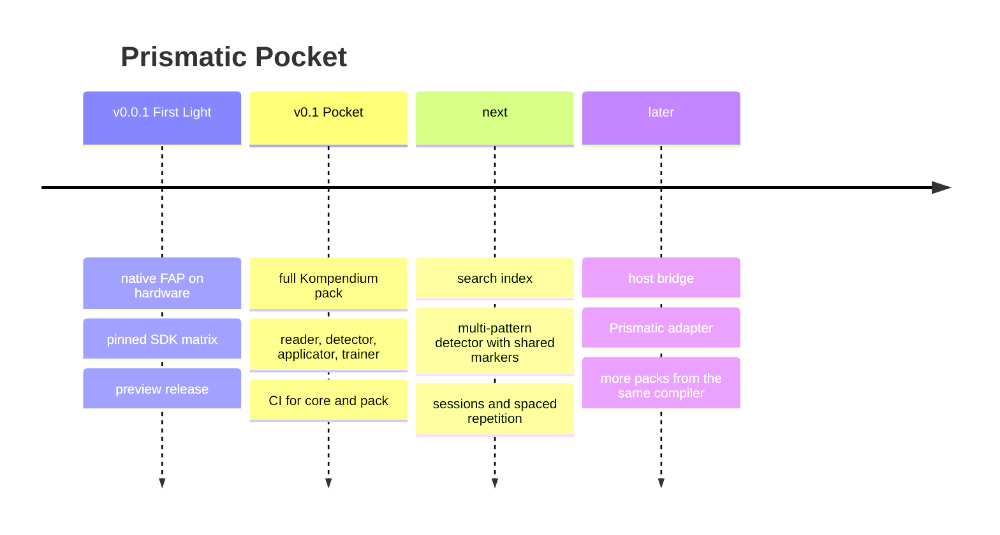

## Licence

The code (runtime, compiler, tools) is [MIT](LICENSE). The knowledge content is the Kompendium
author's work, included by the author's grant; the catalogue's example utterances are included by
the author's explicit decision. Both decisions are recorded in [`knowledge/LICENSE.md`](knowledge/LICENSE.md)
and `.ai/repo/adrs/`. The prism mark is original and generated by [`tools/icons.py`](tools/icons.py).
Flipper Zero is a trademark of Flipper Devices Inc.; this project is not affiliated with it.
