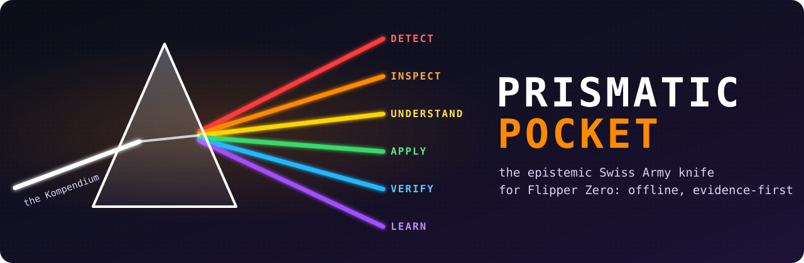
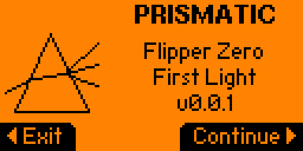
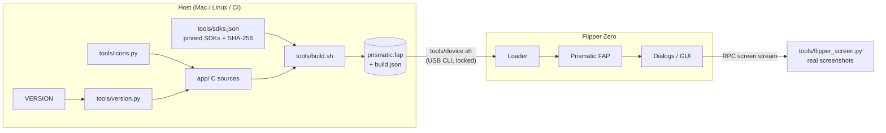
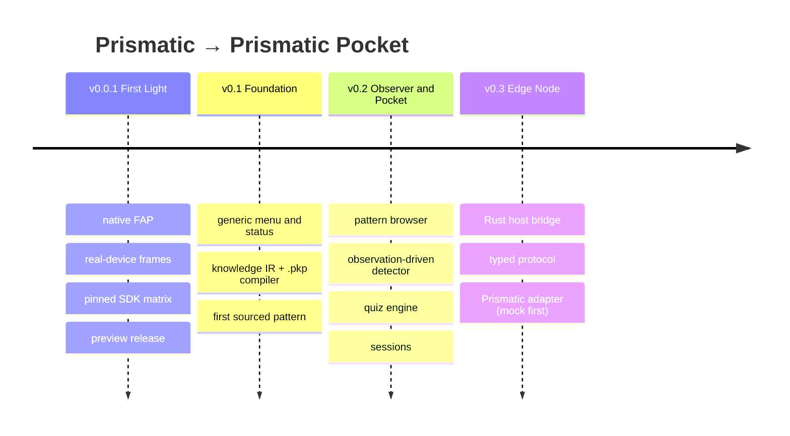

<p align="center">
  
</p>

<p align="center">
  <a href="https://github.com/korczis/prismatic-flipperzero/actions/workflows/ci.yml"></a>
  <a href="https://github.com/korczis/prismatic-flipperzero/releases"></a>
  
  
  <a href="https://majordomus.dev"></a>
  <a href="LICENSE"></a>
</p>

<p align="center">
  <b>Prismatic</b> is a native Flipper Zero application on its way to becoming <b>Prismatic Pocket</b>:<br>
  an offline, evidence-first epistemic toolkit. One small C runtime, many knowledge packs on the SD card.
</p>

---

## On a real device

Every frame below was **read from the Flipper's screen over USB** with
[`tools/flipper_screen.py`](tools/flipper_screen.py) (official RPC screen stream).
Nothing here is a mock-up.

<table>
  <tr>
    <td align="center"><br><sub><b>Launch</b>: the prism mark, name, milestone, version</sub></td>
    <td align="center"><br><sub><b>Continue ▶</b>: firmware version read from the device at runtime</sub></td>
  </tr>
</table>

Recorded on firmware 1.5.1 (API 88.2). Device facts, hashes and the full sequence, Back to
the desktop included, are in [`docs/evidence/first-light`](docs/evidence/first-light/README.md).

## Status

| Capability | State | Evidence |
|---|---|---|
| Native FAP builds against official 1.5.1 (API 88.2) | **VERIFIED** | CI `FAP (official)`, local clean rebuild gives a byte-identical FAP |
| FAP builds against [Momentum](https://github.com/Next-Flip/Momentum-Firmware) mntm-012 (API 87.1) | **BUILD VERIFIED** | CI `FAP (momentum)`; not yet run on a Momentum device |
| Install, launch, navigate, exit on hardware (official 1.5.1) | **VERIFIED** | [real device frames](docs/evidence/first-light/README.md) |
| Release assets with SHA256SUMS and build provenance | **VERIFIED** when the tag's CI run passes | `Prerelease` job re-downloads and runs `sha256sum -c` |
| Knowledge packs (`.pkp`), pattern browser, detector, quiz | **PLANNED**, v0.1–v0.2 | [roadmap](#roadmap) |
| Host bridge (Rust), Prismatic API adapter | **PLANNED**, v0.3+ | |
| Flipper Apps Catalog listing | **NOT SUBMITTED** | |

## Install

**From a release** (no toolchain needed):

1. Download the FAP for your firmware from [Releases](https://github.com/korczis/prismatic-flipperzero/releases):
   `prismatic-<version>-official-api88.2.fap` for official firmware 1.5.x, or
   `prismatic-<version>-momentum-api87.1.fap` for Momentum mntm-012.
2. Check it: `shasum -a 256 -c SHA256SUMS --ignore-missing`.
3. Copy it to `SD Card/apps/Tools/` with qFlipper or the Flipper mobile app.
4. On the Flipper: **Apps → Tools → Prismatic**.

A FAP only loads on firmware with the same API major version. Pick the file whose `api`
matches your device (`Settings → System`, or `device_info` in the CLI).

**From source**, with a Flipper connected:

```bash
just doctor        # what is ready: host, SDKs, GitHub, device, Majordomus
just sdk           # pinned official SDK, SHA-256 checked
just launch        # build, install, start (≈3.5 s on an M-series Mac)
```

<details>
<summary>Without <code>just</code></summary>

```bash
python3 tools/sdk.py install official
tools/build.sh official            # build/official/prismatic.fap + build.json
tools/device.sh launch official    # ufbt launch, behind a device lock
```
</details>

## How it fits together



**One source per fact.** The version lives only in [`VERSION`](VERSION); `app/version.h` and
the manifest's `fap_version` are derived and checked. The icons are generated from geometry in
[`tools/icons.py`](tools/icons.py). SDKs are pinned by URL and SHA-256 in
[`tools/sdks.json`](tools/sdks.json), each in its own `UFBT_HOME`, so a Momentum build never
replaces the official SDK.

## Developer loop

| Recipe | What it does |
|---|---|
| `just doctor` | Readiness in five groups; a missing device is `BLOCKED`, never a build failure |
| `just build [sdk]` | FAP for `official` or `momentum` into `build/<sdk>/`, with provenance JSON |
| `just build-all` | Every SDK in the matrix |
| `just launch` / `just deploy` | Install and start, or install only, behind a device lock |
| `just screenshot` / `just walk DIR KEYS` | Real device frames, optionally after key presses |
| `just test` | Tool tests + line-coverage gate (every line of `tools/*.py`) + the gate's self-test |
| `just verify` | The single verification entry point used by CI and Majordomus |
| `just release-assets` | Versioned FAPs per SDK, provenance and `SHA256SUMS` |

## Roadmap



The direction is **Prismatic Pocket**: a declarative knowledge object (pattern, fallacy,
bias, protocol...) compiled on the host into a read-only `.pkp` pack. The FAP offers browsing,
detection, application steps and quizzes for whatever the pack contains, so a new pattern
ships without touching C. Detection results are candidate patterns with the next
verification steps. They are not probabilities and not judgements about people.

## Firmware compatibility

| Firmware | SDK pin | API | State |
|---|---|---|---|
| [Official](https://github.com/flipperdevices/flipperzero-firmware/releases/tag/1.5.1) 1.5.1 | `flipper-z-f7-sdk-1.5.1.zip` | 88.2 | built in CI, run on hardware |
| [Momentum](https://github.com/Next-Flip/Momentum-Firmware/releases/tag/mntm-012) mntm-012 | `flipper-z-f7-sdk-mntm-012.zip` | 87.1 | built in CI, not run on hardware |

Other firmware has not been tested. Momentum's maintainers don't accept AI-generated
contributions, so this project builds against Momentum's published SDK and never changes the
firmware itself.

## Governance

The repository is supervised by [Majordomus](https://majordomus.dev). Its canonical policy
lives in `.ai/repo/`, the agent instructions [`AGENTS.md`](AGENTS.md), `CLAUDE.md` and
`GEMINI.md` are generated from it, and the tracked hooks in `.githooks/` run
`majordomus doctor` before every commit and the finish contract before every push. CI installs
a pinned Majordomus and runs `doctor` too. These gates have refused real changes during
development: a commit whose README did not name `AGENTS.md`, and a task finish with files
outside its declared scope.

## Security

Receive-only by design: v0.0.1 reads firmware metadata and shows dialogs, with no radio,
no network and no storage writes. The FAP holds no credentials. Release checksums detect
corruption; they are not signatures. Report issues privately, see [SECURITY.md](SECURITY.md).

## License

[MIT](LICENSE). The prism mark is original and generated by [`tools/icons.py`](tools/icons.py).
Flipper Zero is a trademark of Flipper Devices Inc.; this project is not affiliated with it.
