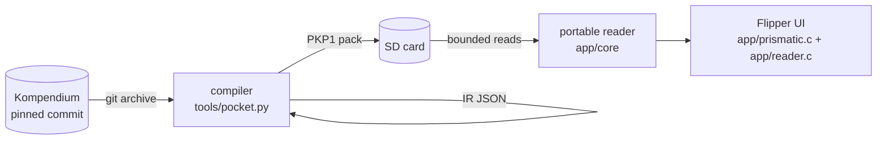

# Architecture

Prismatic Pocket has three parts with one contract between each pair:

## 1. Compiler (`tools/pocket.py`)

`knowledge/sources.json` declares everything that varies:

- **Pages**: the roots to read and the files to skip.
- **Kinds**: which collection becomes which object kind (`techniques` → `technique`,
  `detection-signatures` → `signature`, `glossary` → `concept`, everything else `article`).
- **Roles**: which section heading plays which role: `definition`, `indicators`, `actions`,
  `escalation`, `alternatives`, `validation`, or `skip`. Any other heading becomes a chapter.
- **Overlay**: quick-reference cards merge into the technique with the same EA code.
- **Catalogues**: fallacy and NLP TOML entries merge into the page with the same catalogue id
  (or their canonical page). They contribute aliases and example utterances.

The pipeline runs in a fixed order:

1. Discover (one `git archive` of the pinned commit).
2. Extract (front matter plus sections, with tables and lists as items).
3. Merge.
4. Resolve links into typed relations (`confused_with` for links inside a *don't confuse*
   section, `related_to` for the rest).
5. Validate.
6. Derive capabilities and quizzes.
7. Encode.

The output is deterministic: identical inputs produce identical bytes.

Capabilities are derived, never declared:

- `detect` if the object has markers.
- `apply` if it has actions or escalation.
- `compare` if it has confusables.
- `quiz` if a question could be derived.

## 2. Pack format (PKP1)

The format is little-endian throughout, and every integer is decoded explicitly.

| Part | Content |
|---|---|
| Header (32 B) | magic `PKP1`, version, required-feature flags, file size, **index CRC**, section count, object count, **string-pool CRC** |
| Section directory | `{type, entry size, offset, length, count}` per section |
| META | pack id, title, version, source repository and commit, generator, licence |
| STRINGS | deduplicated ASCII text, referenced as `(offset, length ≤ 2048)` |
| CATEGORIES | `{name, first object, count}`, objects grouped by category |
| OBJECTS | 40-byte records: id, code, title, definition, category, kind, capabilities, item range, relation range |
| ITEMS | `{type, text}`: marker, action, escalation, alternative, validation, chapter heading, chapter text |
| RELATIONS | `{type, target object}` |
| QUIZ | 34-byte records: kind, answer, four options, prompt, context, explanation, response |
| KINDS, RELNAMES | the vocabularies, so a new kind needs no new firmware |

The index CRC covers everything after the header except the string pool and is checked when a
pack is opened. The pool is most of the file and has its own CRC, checked on request; corrupted
text cannot escape its bounds. No two sections may overlap. A pack with unknown required-feature
flags is refused.

## 3. Runtime (`app/`)

- **`app/core/`** is portable C99 with no Furi and no allocation: the pack reader
  (`pkp.c`) and the detector summary and quiz check (`pocket.c`). It is tested on the host under
  sanitizers.
- **`app/reader.c`** is a structured-text view: blocks wrapped to glyph widths, typography from
  one table, selectable links, and a button bar for the detector and quiz.
- **`app/prismatic.c`** is the generic UI. It holds a bounded frame stack; Back pops one frame
  and restores the list selection. Every screen is a function of the pack: home counts, category
  lists, articles with action links, the detector, the trainer, and pack and device info with
  measured open and scan times.

## Boundaries

- The device never decides anything about a person. The detector returns the operator's own
  marks and the book's guidance on what to rule out and what to do next.
- Packs are data. Nothing in a pack is executed.
- The FAP does not depend on the pack's content: a new pack needs no new firmware build.
