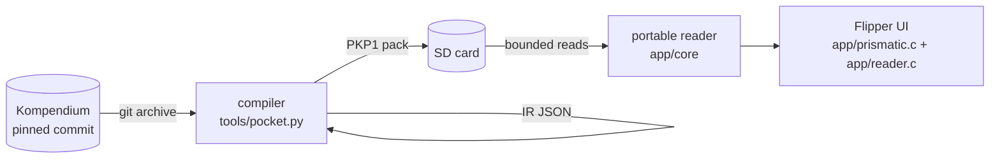

# Architecture

Prismatic Pocket has three parts with one contract between each pair:

## 1. Compiler (`tools/pocket.py`)

`knowledge/sources.json` declares everything that varies:

- **Pages**: the roots to read and the files to skip.
- **Kinds**: which collection becomes which object kind (`techniques` → `technique`,
  `detection-signatures` → `signature`, `glossary` → `concept`, everything else `article`).
- **Roles**: which section heading plays which role: `definition`, `indicators`, `actions`,
  `escalation`, `alternatives`, `validation`, or `skip`. Any other heading becomes a chapter.
- **Overlay**: quick-reference cards merge into the technique with the same EA code.
- **Catalogues**: fallacy and NLP TOML entries merge into the page with the same catalogue id
  (or their canonical page). They contribute aliases and example utterances.

The pipeline runs in a fixed order:

1. Discover (one `git archive` of the pinned commit).
2. Extract (front matter plus sections, with tables and lists as items).
3. Merge.
4. Resolve links into typed relations (`confused_with` for links inside a *don't confuse*
   section, `related_to` for the rest).
5. Validate.
6. Derive capabilities and quizzes.
7. Encode.

The output is deterministic: identical inputs produce identical bytes.

Capabilities are derived, never declared:

- `detect` if the object has markers.
- `apply` if it has actions or escalation.
- `compare` if it has confusables.
- `quiz` if a question could be derived.

## 2. Pack format (PKP1)

The format is little-endian throughout, and every integer is decoded explicitly.

| Part | Content |
|---|---|
| Header (32 B) | magic `PKP1`, version, required-feature flags, file size, **index CRC**, section count, object count, **string-pool CRC** |
| Section directory | `{type, entry size, offset, length, count}` per section |
| META | pack id, title, version, source repository and commit, generator, licence |
| STRINGS | deduplicated ASCII text, referenced as `(offset, length ≤ 2048)` |
| CATEGORIES | `{name, first object, count}`, objects grouped by category |
| OBJECTS | 40-byte records: id, code, title, definition, category, kind, capabilities, item range, relation range |
| ITEMS | `{type, text}`: marker, action, escalation, alternative, validation, chapter heading, chapter text |
| RELATIONS | `{type, target object}` |
| QUIZ | 34-byte records: kind, answer, four options, prompt, context, explanation, response |
| KINDS, RELNAMES | the vocabularies, so a new kind needs no new firmware |

The index CRC covers everything after the header except the string pool and is checked when a
pack is opened. The pool is most of the file and has its own CRC, checked on request; corrupted
text cannot escape its bounds. No two sections may overlap. A pack with unknown required-feature
flags is refused.

## 3. Runtime (`app/`)

- **`app/core/`**: portable C99 with no Furi and no allocation. It holds the pack reader
  (`pkp.c`), the LRU block cache every read goes through (`cache.c`: eight 256-byte blocks), and
  the detector summary and quiz check (`pocket.c`), and is tested on the host under sanitizers.
- **`app/ui/`**: the whole user interface, portable as well. It uses only the canvas API and C99.
  - `page.c` is the one view engine. A page is a pinned header (the title, or the section whose
    heading scrolled by, plus the position), a body of styled blocks and optional softkeys.
    Documents and lists are both pages, and every design rule lives in its tables
    ([`docs/ui.md`](ui.md)).
  - `ui_app.c` is the app: a bounded frame stack and every screen as a function of the pack.
  - `icons.h` is generated by `tools/icons.py`.
- **`app/prismatic.c`**: the Furi glue and nothing else. It opens the pack through the shared
  block cache, forwards keys, draws, and quits on Back from Home or on the loader's exit signal.

### The simulator

`tests/sim` builds the same `app/ui` and `app/core` on the host against the firmware's own
u8g2 renderer and fonts. The sources are fetched from firmware 1.5.1 and checked against
`tests/sim/u8g2.sha256`. A key script drives the app and produces the frames.

- `tools/parity.sh` walks the same keys on the device and in the simulator and compares every
  frame. The last recorded run, in [`docs/evidence/parity/`](evidence/parity/manifest.json),
  found every frame identical.
- `tests/sim/run.sh` runs every scenario in `tests/sim/scenarios.txt` under ASan and UBSan,
  including corrupted packs and an SD card pulled mid-use. Each scenario asserts the visible
  text, and the run fails on any line of `app/ui` that no scenario ran.

## The acceptance test

The architecture stands or falls on one property: adding a knowledge object with capabilities
the app already supports must not touch the app. `tools/acceptance.sh` proves it end to end. It
adds one canonical object ([`tests/acceptance/object.json`](../tests/acceptance/object.json), a
test fixture that never enters the published pack) to the extracted IR, recompiles only the
pack, rebuilds the FAP from the unchanged `app/` and requires the same sha256, then walks to the
object through the generic UI (Library, By chapter, its chapter, its row), runs its detector and
answers its quiz, asserting what the screen shows. The key presses are derived from the pack, not
written down. With `--device` it repeats the walk on the Flipper with the pack deployed as
`acceptance.pkp`, compares every frame with the simulator's and removes the test pack again.
`tools/verify.sh` runs the host part on every verification. The last device run:

<!-- docs:begin acceptance -->
| Step | Result |
|---|---|
| Add one canonical object | [`tests/acceptance/object.json`](../tests/acceptance/object.json) |
| Recompile only the pack | `33a77299bfce50a6` |
| Rebuild the FAP from the unchanged `app/` | the same sha256, `25c82ce4599ee3e9` |
| Find it, run its detector, answer its quiz (simulator) | found through Library > By chapter, detector 2/3 markers, quiz correct |
| The same 34 key presses on the Flipper (firmware 1.5.1) | 35 frames identical to the simulator, 0 different |

Run 2026-11-25 by `tools/acceptance.sh --device`; frames from the device: [result.png](evidence/acceptance/result.png), [answer.png](evidence/acceptance/answer.png).
<!-- docs:end acceptance -->

## Boundaries

- The device never decides anything about a person. The detector returns the operator's own
  marks and the book's guidance on what to rule out and what to do next.
- Packs are data. Nothing in a pack is executed.
- The FAP does not depend on the pack's content: a new pack needs no new firmware build.
