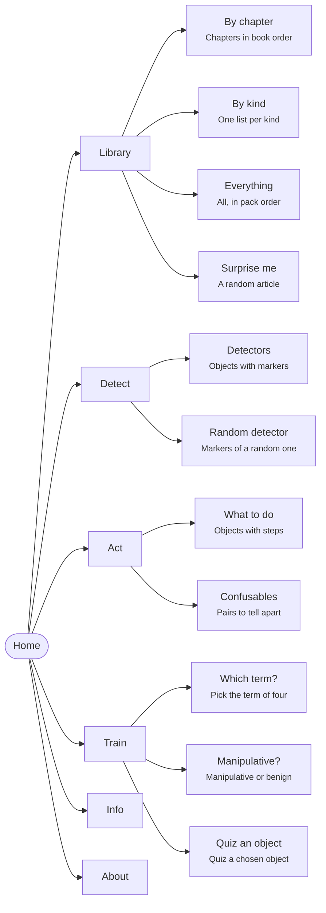

# The interface

Prismatic Pocket runs on a 128 × 64 monochrome LCD. It has five buttons and Back, and its bitmap
fonts are about 7 px tall. This page describes the design system in `app/ui/page.c`, explains
why each rule exists, and shows how the interface is tested.

## Information architecture

Home is a two-column grid of six tiles. Four are hubs, one per intent (read, recognise, act,
train); Info and About fill the third row. A tile shows a 16 px icon, a bold label and the count
behind it, and the status line under the grid explains the focused tile with a count from the
pack ("1212: mark what you saw"). Each hub is a short menu of rows with icons, counts and share
bars; its labels and hints are a table in `app/ui/ui_app.c` and its numbers come from the pack,
so an entry with nothing behind it disappears. This tree is generated from that table:

<!-- docs:begin ia-tree -->

<!-- docs:end ia-tree -->

Rules behind it:

- **Intent first, not data type.** The hubs are what a reader came to do. The pack's own
  structure (chapters, kinds) is one level down, under Library.
- **Two presses to anything frequent.** Every list of objects is two presses from Home, and a
  detector or a question is at most three.
- **Overview, then details on demand.** Counts on the tiles, share bars in the hubs, and the
  status line explains the focused entry instead of a wall of labels.
- **One way home.** Holding Back returns Home from any depth; Back always goes up one level
  and restores the focus and scroll.
- **Grids move in two dimensions.** In the grid the d-pad moves to the neighbouring tile; Left
  and Right stop at the edge instead of wrapping, and Up from below enters the last row at its
  left tile.

## Typography

There are three roles, all from one family:

- **Titles and section headings:** helvB08, the firmware's bold FontPrimary.
- **Reading text:** helvR08, its regular weight. It is embedded in the FAP from the pinned
  firmware's u8g2 by `tools/fonts.py`, because the firmware exports no fonts to apps.
- **Captions:** haxrcorp4089. Used for meta lines, notes, counts, legends and the kind pill.

The regular weight has a real x-height and reads at 11 px pitch. That gives four lines of text
under the header instead of five cramped ones, a trade made for readability.

## One engine, two shapes

Every screen is a **page**. A page has three parts:

- a pinned header;
- a body of styled blocks;
- optional softkeys.

Documents (articles, results, chapters) and lists (menus, options) are both pages. A list is a
page of rows. The look is therefore decided in one place, and a new screen is a new arrangement
of existing blocks, not new drawing code.

| Block | Look | Used for |
|---|---|---|
| Title | bold, wrapped | an article's own name |
| Meta | small line with a dotted rule under it | kind and code, captions |
| Heading | full-width inverted bar, bold | sections; Left/Right jump between them |
| Paragraph / Bullet | regular, 11 px pitch, hanging indent for bullets | text, markers, steps |
| Note | bar on the left | warnings, the detector's "marks only" note |
| Quote | rounded frame | a catalogue utterance in the trainer |
| Link | chevron; focused = inverted rounded box | actions, related objects, chapters |
| Row | icon, label, right-aligned count | menus, lists, quiz options |
| Big | number in the 22 px digit font plus a caption | detector result |
| Bar | stacked bar (solid, empty, dots, hatch) with a legend | the share of each mark |
| Steps | one cell per step, current one framed | detector progress |
| Badge | the kind in tracked capitals inside an inverted pill, then the code | an article's identity |
| Chip | rounded box with an icon and a count; focused = inverted | an article's actions: detector, quiz, map |
| Row bar | 14 px mini bar before a row's count (square-root scale) | hub entries, chapters, kinds |
| Tile | 16 px icon, bold label, caption count; focused = inverted rounded box, others open with dotted rules | the Home grid |
| Status line | dotted rule, then the focused block's hint in the caption face | Home and hubs |

Two more surfaces sit on top of pages:

- **The context menu.** Hold OK on any page without softkeys. A panel with a drop shadow opens
  over the page, whose pixels are half cleared so it recedes without adding noise, with the page's actions: the detector, the quiz, the map of links, the category and
  Home. The engine adds **Contents** whenever the page has two or more sections. Contents lists
  the page's own headings, and choosing one moves that heading into the header.
- **The map of links.** This is a bounded local graph: the object in the centre and four
  neighbours around it (top, right, bottom, left). Confusable objects sit on dotted edges and
  related ones on solid edges. The focused neighbour's full name replaces the title in the
  header, and the header counts the windows of four ("2/3").

## Geometry

The table below is read from the engine's `#define`s by `tools/docs.py`. Do not edit it by hand.

<!-- docs:begin ui-geometry -->
| Constant | Value | Meaning |
|---|---:|---|
| `TEXT_CAP` | 12288 | text per page |
| `BLOCK_CAP` | 220 | blocks per page |
| `LINE_CAP` | 900 | laid-out lines per page |
| `SCREEN_W` | 128 px | display width |
| `SCREEN_H` | 64 px | display height |
| `HEADER_H` | 13 px | pinned header (title, position, rule) |
| `SOFT_H` | 12 px | softkey bar |
| `LEFT` | 2 px | left text margin |
| `RIGHT` | 123 px | last text column (scrollbar right of it) |
| `LEADING` | 11 px | body line pitch |
| `ROW_H` | 12 px | list row |
| `HEADING_H` | 13 px | section heading bar |
| `BIG_H` | 24 px | big-number result line |
| `BAR_H` | 21 px | stacked bar with legend |
| `GAP` | 3 px | space after a paragraph |<!-- docs:end ui-geometry -->

## Navigation contract

| Key | Documents | Lists | With softkeys |
|---|---|---|---|
| Up / Down | next link in view takes the focus, else the text moves one line | next row (wraps) | scroll |
| Left / Right | previous / next section, whose heading and icon move into the header; on a row of chips, the next chip | four rows up / down | left / right softkey |
| Hold Up / Down | same as Left / Right | same | same |
| OK | open the focused link | open the row | centre softkey (hold = its long action) |
| Back | one step back, restoring the scroll and the focused row | same | same |
| Hold OK | context menu (Back or holding OK again closes it) | context menu | the softkey's long action |

On the map, a direction focuses the neighbour on that side. The same direction again shows the
next four neighbours, and the opposite direction returns to the centre. OK on a neighbour
re-centres the map there, so you can walk the book's links. Holding OK opens the neighbour's
article, and OK on the centre opens the centre's article.

These rules are taken from earlier small-screen designs:

- **Actions first.** An article lists its actions (detector, quiz) before the definition, so one
  Down reaches them. Palm OS: frequent commands get one tap.
- **Feature-phone browsing.** A press either focuses the next link in view or moves the text.
  This is how WAP browsers made links reachable with a d-pad.
- **Sticky section heading.** The header always says which section you are in and where it
  sits ("2/5"), the way a TI-83 title line names its current menu.
- **Softkeys at fixed places.** Firmware-style inverted tabs keep the same position for the same
  meaning (TI-83 guidelines), and the detector's answers never move.
- **No wall of text.** After three lines, a paragraph breaks at its next sentence end and
  leaves a 3 px gap, so a long definition reads as short blocks.
- **Details on demand.** The map's side boxes hold a few characters. The full name of the
  focused box appears in the header.
- **Body text at 11 px pitch** in helvR08, four lines under the header. Shorter lines with a
  real x-height read better than more cramped lines (Duchnicky and Kolers, 1983).
- **No scores.** The detector shows the operator's own marks as a number, a bar and a legend,
  never a percentage or a verdict.

## Reviews of the whole atlas

Every UI change is reviewed on the [screen atlas](../README.md#every-screen), not on one screen
(rule `project.ui-atlas`). The contact sheet and the frame captions go to an independent
reviewer, and each finding is recorded here with what was done.

### 2026-11-25: Codex, 31 frames after the hub redesign

| # | Finding | Decision |
|---|---|---|
| 1 | Home tiles: label, count and hint compete | Kept the tiles; counts became bare numbers, and the hint moved to the status line with its unit. |
| 2 | Truncated names in lists lose their identity | Open. A focused row that grows to two lines needs focus-dependent layout; planned. |
| 3 | Page position reads like a count | Kept: paged lists already say `p1/31`; plain `1/6` is a position among rows. |
| 4 | Bare hub counts | Each hub row now carries a share bar, and the status line says what it counts. |
| 5 | Chips look like decoration | Kept: chips carry icons and invert on focus; words do not fit three chips in 124 px. |
| 6 | The menu's stipple adds noise | Done: half the page's pixels are cleared instead of dots added, and the panel has a drop shadow. |
| 7 | Map shows four neighbours | Kept: the bounded graph is the point; the focused name is already in the header. |
| 8 | `?` is ambiguous | Done: the detector's centre softkey says `Unsure`. |
| 9 | The result bar reads as a score | Kept: the bar is the composition of four kinds of mark with a legend, and the note says it is not a score. |
| 10 | Quiz position is not shown | Open: needs a session counter. |
| 11 | Trainer verdict competes with text | Kept: the verdict is the header (`Correct`, `Not quite`) and the first caption line. |
| 12 | No-pack guidance buried | Done: Home says "No knowledge pack yet. Info says how to add one." |

The same pass found two defects by eye: the detector legend fell back to bare numbers (fixed
by a tighter swatch spacing), and the Info tile's caption was cut (now `device`).

## How it is tested

- **The simulator.** `tests/sim` builds the same `app/ui` on the host against the firmware's own
  u8g2 and fonts. [`docs/evidence/parity`](evidence/parity/manifest.json) records a run in
  which the device and the simulator drew identical frames for the same keys.
- **Scenarios.** `tests/sim/scenarios.txt` lists the key paths. Each one asserts the visible
  text: the header and position, focused rows, and softkeys. The scenarios run under ASan and
  UBSan on hermetic packs, including corrupted records and an SD card pulled mid-use.
  `tests/sim/run.sh` fails on any line of `app/ui` that no scenario ran.
- **The atlas.** `tests/sim/atlas.txt` walks to every screen and overlay;
  `tools/atlas.py --check` (run by `tests/sim/run.sh`) fails when a `Screen` has no frame, a
  walk ends elsewhere than it declares, or a frame in `docs/evidence/atlas` is stale.
- **Hardware.** Every frame in the README's device gallery is read from the device's screen, and
  `tools/parity.sh` records the device and the simulator drawing identical frames for the same
  keys.
