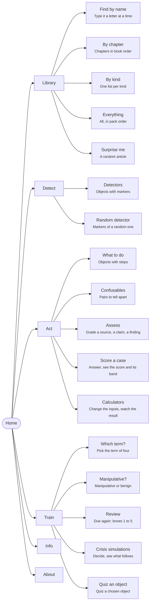

# The interface

Prismatic Pocket runs on a 128 × 64 monochrome LCD. It has five buttons and Back, and its bitmap
fonts are about 7 px tall. This page describes the design system in `app/ui/page.c`, explains
why each rule exists, and shows how the interface is tested.

## Information architecture

Home is a two-column grid of six tiles. Four are hubs, one per intent (read, recognise, act,
train); Info and About fill the third row. A tile shows a 16 px icon, a bold label and the count
behind it, and the status line under the grid explains the focused tile with a count from the
pack ("1212: mark what you saw"). Each hub is a short menu of rows with icons, counts and share
bars; its labels and hints are a table in `app/ui/ui_app.c` and its numbers come from the pack,
so an entry with nothing behind it disappears. This tree is generated from that table:

<!-- docs:begin ia-tree -->

<!-- docs:end ia-tree -->

Rules behind it:

- **Intent first, not data type.** The hubs are what a reader came to do. The pack's own
  structure (chapters, kinds) is one level down, under Library.
- **Two presses to anything frequent.** Every list of objects is two presses from Home, and a
  detector or a question is at most three.
- **Overview, then details on demand.** Counts on the tiles, share bars in the hubs, and the
  status line explains the focused entry instead of a wall of labels.
- **One way home.** Holding Back returns Home from any depth; Back always goes up one level
  and restores the focus and scroll.
- **Grids move in two dimensions.** In the grid the d-pad moves to the neighbouring tile; Left
  and Right stop at the edge instead of wrapping, and Up from below enters the last row at its
  left tile.
- **Values change in place, in real time.** A stepper row ("label  < value >") takes Left and
  Right as "previous" and "next" value, on every press and on key repeat, and OK as "next". The
  screen recomputes from a few bytes of state (a choice index per scale or question) and redraws
  at once with the focus kept, so the result in the header moves as the reader runs through the
  values; nothing waits for a confirm. The status line says what the focused value means, or
  "Left/Right change ..." when the source gives no meaning.

### Review: spaced repetition

Every answered question goes into a Leitner box on the SD card: a right answer moves it up one
box, a wrong one back to box 1, and box *n* comes back after 2^(n-1) sessions (a session is a
start of the app). **Train > Review** appears once something is due and asks the lowest box
first; each answer offers the next due question. A question whose text changed in a rebuilt pack
no longer matches its stored key and is dropped. Info shows how many questions are filed and
offers to forget them, behind a confirmation; the file holds only the reader's own answers.

### Side by side: differential detection

An article whose look-alikes (its *Don't confuse with* links) have markers of their own offers
**Compare with a look-alike** in its context menu. The detector then walks both objects'
markers in a row, the header naming whose marker is on screen, and the result shows each
object's marks as a count and a bar, with a link to each article. It never ranks the two or says
which one "it is": two sets of the reader's own marks, side by side, are what the screen shows.

### Applications: assessments on one live screen

Objects with the capability `assess` (Act > Assess) are tools for grading: the Admiralty code
(source A-F, claim 1-6), the due-diligence evidence level (0-9) and the OSINT confidence levels,
from `knowledge/applications.toml`. **Assess** (a chip and a menu entry) shows every scale on
one screen as a stepper: Left/Right run through its grades, the code builds in the header as
you go ("B2"), and the status line shows what the focused grade means. **See the grade** opens
the result, which
puts the chosen codes together ("B2"), then each scale's grade with its meaning, then what to do
with the grade and how to grade. The device never computes a grade; the reader chooses, the
screen records and explains. A new scale is data, not code.

### Scorecards

Act > Score a case runs the Prismatic Platform's deterministic scoring rules: the executive
frame (a deal's risk rating A to F from gaps in its intake) and the nominee-shareholder check
(evidence for and against a front owner). Every question is a stepper on one screen, its answer
shown with the weight first (`< +10 No, empty ... >`); Left/Right change an answer and the score
and band in the header follow at once, and the status line shows the note the focused answer
carries (a red flag and its evidence). The result is the score, its band and what it means, and every answer
that moved it with its note. The base, weights, clamp and bands are the source's, as data in
`knowledge/applications.toml`; a new scorecard needs no code.

### Calculators

Act > Calculators holds the Prismatic Platform's portable algorithms with their parameters as
data. The first is its Bayesian fusion of independent sources (`CorrelationEngine.bayesian_fusion`):
choose a source's confidence with Left/Right on the "Add a source" stepper and add it with OK,
move the prior on its own stepper, take the last source back or start over; all of it fits the
first screen, the picture of the belief (a big number and a belief/doubt bar) follows below, and
the
belief stays in view in the header with its status (confirmed at 90% or above, rejected at 10%
or below, as the platform's hypothesis lifecycle says) in the status line. The device computes
what the source's code computes; its documentation's example (0.8, 0.7, 0.9 giving 0.976) does
not match that code, which gives 0.988, and the device follows the code.

### Crisis simulations

Train > Crisis simulations runs the Prismatic Platform's tabletop exercises (hostage
negotiation, active shooter, chemical incident, cyber attack and more), imported as data by
`tools/prismatic_import.py`. Each step shows the situation and the options with their risk;
choosing one shows its consequence and what it did to trust (shown as a number and a bar).
After the last step the outcome follows the source's own rules, with every decision and its
trust change. Back returns to a step and a new choice replaces the old one: the state is
recomputed from the choices, so nothing counts twice. Every run says it is a training exercise,
not guidance for a real emergency.

### Saved sessions

A detector's result, single or side by side, offers **Save these marks**; nothing is stored
until the reader presses it. A saved session is one line of JSON appended to
`SD:/apps_data/prismatic/sessions.jsonl` (at most 32 KiB): the time from the device clock, the
pack, and for each object its stable id, its index and the marks, one letter each (O observed,
N not observed, U unknown, A not applicable). The file is its own export: copy it to a computer
and read it with any JSON Lines tool. Info lists the sessions newest first and deletes them
behind a confirmation. A line torn off by a lost write is skipped, and the next save starts on a
new line so it is not lost with it.

### Find by name

**Library > Find by name** types a name a letter at a time on a wheel of its own, not the
firmware's on-screen keyboard (that needs a view dispatcher and would not run in the simulator,
the atlas or the parity test). The query sits left in bold with a cursor; the wheel sits right,
five letters with the current one inverted. **Up/Down** turn the wheel, **Right** adds its letter,
**Left** deletes one and **holding Left** deletes all, **OK** lists every match, **Back** leaves.
The header counts the matches and the body shows the best three.

The wheel offers only letters that some indexed word continues with, so a query can never reach
zero matches and no letter is typed in vain. A word matches when it *starts with* the query:
words of the title and of the aliases, the code's words and the code without its punctuation
(`EA-3.2.F` is also `ea32f`), folded to ASCII and cut to ten characters; definitions are not
searched. Matches whose title starts with the word (after a leading code) or whose code matches
are listed first, each group in book order. The [online explorer](https://korczis.github.io/prismatic-flipperzero/)
searches differently: it finds the query *anywhere* in a title, code or alias, as a browser can
afford to.

What a step costs the SD card is measured in the simulator over the real pack
([the cache, measured](../README.md#the-cache-measured)): opening Find checks the whole index
once per pack, a first letter reads a few dozen 256-byte blocks, a third letter a handful, and
turning the wheel reads nothing. No time on the device is claimed. A pack without the index (an
older compiler's) or with more than 4 096 objects says so on the Find screen, and Info shows the
index's size and its check.

## Typography

There are three roles, all from one family:

- **Titles and section headings:** helvB08, the firmware's bold FontPrimary.
- **Reading text:** helvR08, its regular weight. It is embedded in the FAP from the pinned
  firmware's u8g2 by `tools/fonts.py`, because the firmware exports no fonts to apps.
- **Captions:** haxrcorp4089. Used for meta lines, notes, counts, legends and the kind pill.

The regular weight has a real x-height and reads at 11 px pitch. That gives four lines of text
under the header instead of five cramped ones, a trade made for readability.

## One engine, two shapes

Every screen is a **page**. A page has three parts:

- a pinned header;
- a body of styled blocks;
- optional softkeys.

Documents (articles, results, chapters) and lists (menus, options) are both pages. A list is a
page of rows. The look is therefore decided in one place, and a new screen is a new arrangement
of existing blocks, not new drawing code.

| Block | Look | Used for |
|---|---|---|
| Title | bold, wrapped | an article's own name |
| Meta | small line with a dotted rule under it | kind and code, captions |
| Heading | full-width inverted bar, bold | sections; Left/Right jump between them |
| Paragraph / Bullet | regular, 11 px pitch, hanging indent for bullets | text, markers, steps |
| Note | bar on the left | warnings, the detector's "marks only" note |
| Quote | rounded frame | a catalogue utterance in the trainer |
| Link | chevron; focused = inverted rounded box | actions, related objects, chapters |
| Row | icon, label, right-aligned count | menus, lists, quiz options |
| Big | number in the 22 px digit font plus a caption | detector result |
| Bar | stacked bar (solid, empty, dots, hatch) with a legend | the share of each mark |
| Steps | one cell per step, current one framed | detector progress |
| Badge | the kind in tracked capitals inside an inverted pill, then the code | an article's identity |
| Chip | rounded box with an icon and a count; focused = inverted | an article's actions: detector, quiz, map |
| Row bar | 14 px mini bar before a row's count (square-root scale) | hub entries, chapters, kinds |
| Tile | 16 px icon, bold label, caption count; focused = inverted rounded box, others open with dotted rules | the Home grid |
| Stepper | a row whose value sits in `< >` on the right, at most two thirds of the width so the label shows; a long value is shortened inside the arrows | assessments, scorecards, the calculator's source and prior |
| Status line | dotted rule, then the focused block's hint in the caption face | Home and hubs |

Two more surfaces sit on top of pages:

- **The context menu.** Hold OK on any page without softkeys. A panel with a drop shadow opens
  over the page, whose pixels are half cleared so it recedes without adding noise, with the page's actions: the detector, the quiz, the map of links, the category and
  Home. The engine adds **Contents** whenever the page has two or more sections. Contents lists
  the page's own headings, and choosing one moves that heading into the header.
- **The map of links.** This is a bounded local graph: the object in the centre and four
  neighbours around it (top, right, bottom, left). Confusable objects sit on dotted edges and
  related ones on solid edges. The focused neighbour's full name replaces the title in the
  header, and the header counts the windows of four ("2/3").

## Geometry

The table below is read from the engine's `#define`s by `tools/docs.py`. Do not edit it by hand.

<!-- docs:begin ui-geometry -->
| Constant | Value | Meaning |
|---|---:|---|
| `TEXT_CAP` | 12288 | text per page |
| `BLOCK_CAP` | 220 | blocks per page |
| `LINE_CAP` | 900 | laid-out lines per page |
| `SCREEN_W` | 128 px | display width |
| `SCREEN_H` | 64 px | display height |
| `HEADER_H` | 13 px | pinned header (title, position, rule) |
| `SOFT_H` | 12 px | softkey bar |
| `LEFT` | 2 px | left text margin |
| `RIGHT` | 123 px | last text column (scrollbar right of it) |
| `LEADING` | 11 px | body line pitch |
| `ROW_H` | 12 px | list row |
| `HEADING_H` | 13 px | section heading bar |
| `BIG_H` | 24 px | big-number result line |
| `BAR_H` | 21 px | stacked bar with legend |
| `GAP` | 3 px | space after a paragraph |<!-- docs:end ui-geometry -->

## Navigation contract

| Key | Documents | Lists | With softkeys |
|---|---|---|---|
| Up / Down | next link in view takes the focus, else the text moves one line | next row (wraps) | scroll |
| Left / Right | previous / next section, whose heading and icon move into the header; on a row of chips, the next chip | four rows up / down | left / right softkey |
| Hold Up / Down | same as Left / Right | same | same |
| OK | open the focused link | open the row | centre softkey (hold = its long action) |
| Back | one step back, restoring the scroll and the focused row | same | same |
| Hold OK | context menu (Back or holding OK again closes it) | context menu | the softkey's long action |

On Find the keys turn the letter wheel instead (Up/Down a letter, Right add, Left delete, hold
Left clear, OK the matches); Back and holding Back work as everywhere.

On the map, a direction focuses the neighbour on that side. The same direction again shows the
next four neighbours, and the opposite direction returns to the centre. OK on a neighbour
re-centres the map there, so you can walk the book's links. Holding OK opens the neighbour's
article, and OK on the centre opens the centre's article.

These rules are taken from earlier small-screen designs:

- **Actions first.** An article lists its actions (detector, quiz) before the definition, so one
  Down reaches them. Palm OS: frequent commands get one tap.
- **Feature-phone browsing.** A press either focuses the next link in view or moves the text.
  This is how WAP browsers made links reachable with a d-pad.
- **Sticky section heading.** The header always says which section you are in and where it
  sits ("2/5"), the way a TI-83 title line names its current menu.
- **Softkeys at fixed places.** Firmware-style inverted tabs keep the same position for the same
  meaning (TI-83 guidelines), and the detector's answers never move.
- **No wall of text.** After three lines, a paragraph breaks at its next sentence end and
  leaves a 3 px gap, so a long definition reads as short blocks.
- **Details on demand.** The map's side boxes hold a few characters. The full name of the
  focused box appears in the header. In lists, a name that does not fit scrolls by characters
  once the focus has rested on it for 2.5 s, rests at its end and starts over, as feature
  phones did; the pause keeps a moving label from distracting someone still scanning the list.
- **Body text at 11 px pitch** in helvR08, four lines under the header. Shorter lines with a
  real x-height read better than more cramped lines (Duchnicky and Kolers, 1983).
- **No scores.** The detector shows the operator's own marks as a number, a bar and a legend,
  never a percentage or a verdict.

## Reviews of the whole atlas

Every UI change is reviewed on the [screen atlas](../README.md#every-screen), not on one screen
(rule `project.ui-atlas`). The contact sheet and the frame captions go to an independent
reviewer, and each finding is recorded here with what was done.

### 2026-11-25: Codex, 31 frames after the hub redesign

| # | Finding | Decision |
|---|---|---|
| 1 | Home tiles: label, count and hint compete | Kept the tiles; counts became bare numbers, and the hint moved to the status line with its unit. |
| 2 | Truncated names in lists lose their identity | Done: a focused row whose name is cut scrolls it by characters after 2.5 s of rest, pauses at the end and starts over (the feature-phone marquee); `page_tick` drives it from the app's idle loop. |
| 3 | Page position reads like a count | Kept: paged lists already say `p1/31`; plain `1/6` is a position among rows. |
| 4 | Bare hub counts | Each hub row now carries a share bar, and the status line says what it counts. |
| 5 | Chips look like decoration | Kept: chips carry icons and invert on focus; words do not fit three chips in 124 px. |
| 6 | The menu's stipple adds noise | Done: half the page's pixels are cleared instead of dots added, and the panel has a drop shadow. |
| 7 | Map shows four neighbours | Kept: the bounded graph is the point; the focused name is already in the header. |
| 8 | `?` is ambiguous | Done: the detector's centre softkey says `Unsure`. |
| 9 | The result bar reads as a score | Kept: the bar is the composition of four kinds of mark with a legend, and the note says it is not a score. |
| 10 | Quiz position is not shown | Done: the quiz header counts the session's right answers ("3 of 4") once there is one. |
| 11 | Trainer verdict competes with text | Kept: the verdict is the header (`Correct`, `Not quite`) and the first caption line. |
| 12 | No-pack guidance buried | Done: Home says "No knowledge pack yet. Info says how to add one." |

The same pass found two defects by eye: the detector legend fell back to bare numbers (fixed
by a tighter swatch spacing), and the Info tile's caption was cut (now `device`).

### 2026-11-26: Find by name, self-review (no independent reviewer)

The new frames (`find-empty`, `find-typed`, `find-results`) and the two that changed
(`hub-library`, which gained the first row, and `info-cache`, which gained the index check) were
reviewed by the implementing agent against the rendered frames and their captions. No second
model or peer reviewed them; that review is still owed. Every other frame of the atlas rendered
byte for byte as before, which also proves that the key paths shifted for the new Library row
reach the same screens.

| # | Finding | Decision |
|---|---|---|
| 1 | The magnifier icon on Find repeated the Detect hub's, two meanings for one mark | Done: Find has its own icon, a letter and a cursor (`tools/icons.py`). |
| 2 | A bare number in the header ("72") did not say what it counts | Done: the header says `72 found`. |
| 3 | The key help is gone once the first letter is typed | Kept: once a letter is typed the lines belong to the matches; the help is back on the empty query, one held Left away. |
| 4 | The wheel's neighbours are in the caption face, the current letter in the title face, so the strip reads unevenly | Kept: the difference is the point (what Right adds stands out), and the box marks it twice. |
| 5 | An empty query shows a lone cursor at the left | Kept: the wheel and the help below it say what to do; a placeholder word would read as a query. |
| 6 | Titles under the wheel are cut with an ellipsis | Kept: OK opens the full list, where a focused row scrolls its whole name. |

## How it is tested

- **The simulator.** `tests/sim` builds the same `app/ui` on the host against the firmware's own
  u8g2 and fonts. [`docs/evidence/parity`](evidence/parity/manifest.json) records a run in
  which the device and the simulator drew identical frames for the same keys.
- **Scenarios.** `tests/sim/scenarios.txt` lists the key paths. Each one asserts the visible
  text: the header and position, focused rows, and softkeys. The scenarios run under ASan and
  UBSan on hermetic packs, including corrupted records and an SD card pulled mid-use.
  `tests/sim/run.sh` fails on any line of `app/ui` that no scenario ran.
- **The atlas.** `tests/sim/atlas.txt` walks to every screen and overlay;
  `tools/atlas.py --check` (run by `tests/sim/run.sh`) fails when a `Screen` has no frame, a
  walk ends elsewhere than it declares, or a frame in `docs/evidence/atlas` is stale.
- **Hardware.** Every frame in the README's device gallery is read from the device's screen, and
  `tools/parity.sh` records the device and the simulator drawing identical frames for the same
  keys.
